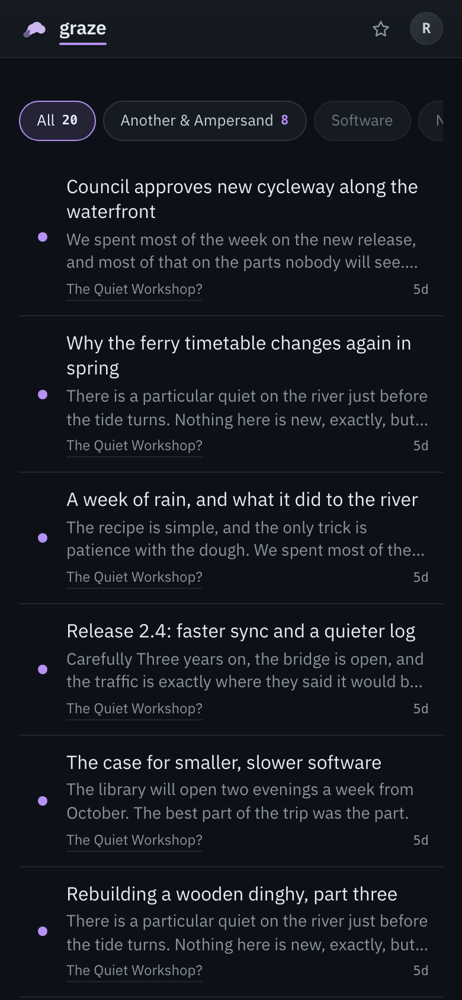
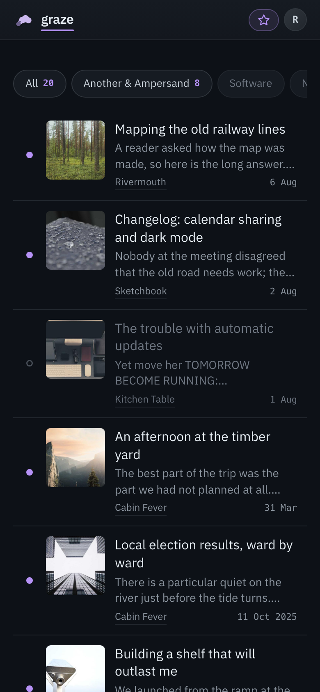
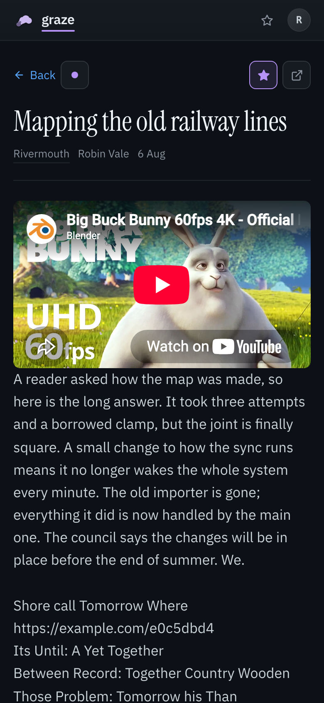

# Graze

A reading client for [FreshRSS](https://freshrss.org), built for the phone. I built it
because FreshRSS is a good place to keep feeds and a poor place to read them on a small
screen. Graze covers the reading: lists, articles, read and star. Managing feeds stays in
FreshRSS.

> **This is a showcase snapshot.** The code is the real project, published as a single commit
> without its history or deployment config. The test fixtures were captured from a live
> FreshRSS instance and then made synthetic: feed names, words and URLs are replaced, and the
> response shapes are left exactly as FreshRSS sent them. The screenshots are graze running
> against those fixtures.

| All, with excerpts | Starred, with lead images | An article |
|---|---|---|
|  |  |  |

## What it does

- **Lists**: All, one category, one feed, or starred. A chip bar switches between categories
  and shows their unread counts. Rows can show an excerpt and a lead image, switched on or off
  per device.
- **Reading**: opening an article marks it read. Each row has a dot that marks it read or
  unread without opening it, with Undo. The avatar menu marks everything read.
- **Articles**: the HTML is cleaned up for a narrow screen. Lazy images are loaded, images
  are fetched without a referrer, a comic's title-attribute punchline becomes a caption, and
  when FreshRSS fetched the full text, only the full text is shown.
- **No state of its own**: FreshRSS owns feeds, articles, read state and stars. Graze keeps an
  auth token and a short-lived cache of the subscription list, and nothing else. It never
  fetches an article's original page.

## Architecture

```
phone ──HTML + HTMX──▶ graze ──GReader API──▶ FreshRSS
```

The whole thing is one Go package using only the standard library (`net/http`,
`html/template`) plus `golang.org/x/net/html`. HTMX is loaded from a CDN with SRI, and there is
no JavaScript build step. It is about 1,700 lines of Go, with about as many again in tests.

| File | What |
|---|---|
| [`main.go`](main.go) | Config, routes, request logging, the CSP |
| [`greader.go`](greader.go) | The FreshRSS client: login, token refresh, protocol types |
| [`handlers.go`](handlers.go) | Handlers, view models, templates |
| [`list.go`](list.go) | The list a page shows or an article came from, and every URL that carries it |
| [`content.go`](content.go) | The article HTML rewrite and sanitising pass |
| [`CONTEXT.md`](CONTEXT.md) | The vocabulary: feed, article, category, label, read, star… |

## Things worth a look

- **Treating article HTML as hostile, twice.** FreshRSS sanitises HTML before storing it, but
  one of its extensions adds a video iframe *after* sanitising. So
  [`content.go`](content.go) rebuilds each iframe from a host allowlist and a fixed set of
  attributes, instead of stripping a few known-bad ones (`srcdoc` would run in graze's own
  origin). Graze's own rewrite reparses and reserialises markup, and those two steps are not
  inverses: a string that arrived inert inside an attribute can come out as an element. So the
  strip pass runs over the output too, and every response carries a CSP with a per-request
  script nonce as a second lock. `rewriteContent` is the only function allowed to mint
  `template.HTML`.
- **One request per page, so counts and rows agree.** A list page fans out on the server to
  `subscription/list`, `unread-count` and `stream/contents`, so the chip counts and the rows
  come from the same moment. Infinite scroll is an HTMX request that returns the next rows and
  a fresh sentinel, and nothing else.
- **Tested against recorded responses, not mocks.** The GReader client runs against an
  `httptest.Server` that serves responses [captured from a real
  instance](testdata/README.md), because the response shapes are what is most likely to be
  wrong: `summary` versus `content`, string versus number ids, fields omitted when empty,
  feed titles escaped to fullwidth look-alikes. The tests work out their expected values
  from the fixtures, so a recapture does not break them. Handlers are tested end to end
  through `httptest.NewRequest`.
- **A domain vocabulary kept on purpose.** [`CONTEXT.md`](CONTEXT.md) fixes the words
  (article, not item or post; star, not bookmark), and the code, templates and commits use
  only those.

## Tests

```bash
mise exec -- go test ./...
```

56 test functions, covering the client, the handlers, the content rewrite, list URLs and time
formatting. CI ([`.github/workflows/ci.yml`](.github/workflows/ci.yml)) runs `go vet` and the
tests on every push.

## Working with AI agents

I build this with Claude Code. [`CLAUDE.md`](CLAUDE.md) is the guidance the agent works from:
the architecture, what is trusted and why, and how testing works. It is also the densest
technical documentation in the repo.

## Running it

Needs [mise](https://mise.jdx.dev) (or Go 1.26) and a FreshRSS instance with the API enabled.

```bash
FRESHRSS_API_URL=https://rss.example.com/api/greader.php \
FRESHRSS_API_USER=you FRESHRSS_API_PASSWORD=... \
  mise exec -- go run .     # http://localhost:8080
```

In production, a forward-auth proxy sets the `Remote-User` header, and a request without it
gets a 401. Locally, `DEV_USER` in `mise.toml` stands in for that header.
[`docker-compose.yml`](docker-compose.yml) runs graze next to a FreshRSS container on the same
Docker network. Copy [`example-secret.env`](example-secret.env) to `secret.env` first.

| Variable | Default | Purpose |
|---|---|---|
| `PORT` | `8080` | Listen port. |
| `FRESHRSS_API_URL` | `http://freshrss:80/api/greader.php` | The GReader endpoint. |
| `FRESHRSS_API_USER` | — | FreshRSS username. |
| `FRESHRSS_API_PASSWORD` | — | The **API** password set in FreshRSS's profile, not the login password. |
| `FRESHRSS_WEB_URL` | — | Where *Open FreshRSS* points. |
| `GRAZE_DEFAULT_TZ` | `UTC` | Used when the browser has not set the `tz` cookie. |
| `GRAZE_EMBED_HOSTS` | — | Comma-separated PeerTube hosts whose `/videos/embed/` iframes may be shown. YouTube is always allowed, and nothing else is. |

## Licence

MIT; see [`LICENSE`](LICENSE). The bundled fonts (IBM Plex Sans, Instrument Serif) are under
the SIL Open Font License; see [`static/fonts/OFL.txt`](static/fonts/OFL.txt).
